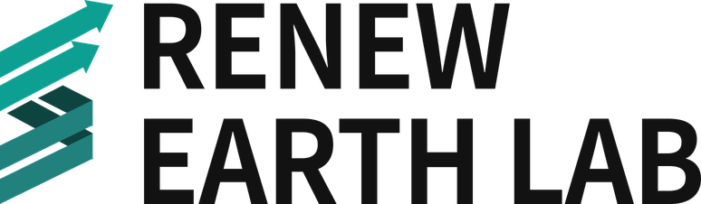

  <a href="https://www.carbonlink.co.kr">
    <picture>
      <source media="(prefers-color-scheme: dark)" srcset="./assets/logo-dark.png">
      
    </picture>
  </a>

<h3 align="center">Supply-chain carbon accounting, automated.</h3>

  We build <b>CarbonLink</b> — collect, calculate, verify and report supply-chain emissions in one place. 
  Trusted by 350+ manufacturers for CBAM, CDP and CSDDD. 
  공급망 탄소 데이터의 수집·산정·검증·보고를 자동화하는 카본링크를 만듭니다.

  <a href="https://www.carbonlink.co.kr"><b>Website</b></a> ·
  <a href="https://www.carbonlink.co.kr/bbs/content.php?co_id=blog"><b>Blog</b></a> ·
  <a href="https://salesmap.kr/web-form/b3c5cc7c-67af-4498-b226-85db6bc98b63"><b>Contact</b></a>

